# bioGeometry user guide

This guide covers using the bioGeometry workbench: loading a structure, selecting, reading the views, measuring and analysing, and exporting. Installation and the algorithms are covered in the [README](../README.md).

Contents:

1. [The screen](#1-the-screen)
2. [Loading a structure](#2-loading-a-structure)
3. [Selecting](#3-selecting)
4. [Structure view](#4-structure-view)
5. [Geometry view](#5-geometry-view)
6. [Ramachandran, contacts and PAE](#6-ramachandran-contacts-and-pae)
7. [The data dock](#7-the-data-dock)
8. [Measuring a selection](#8-measuring-a-selection)
9. [Analyses](#9-analyses)
10. [Large assemblies and AlphaFold models](#10-large-assemblies-and-alphafold-models)
11. [DNA, RNA and the standalone workbench](#11-dna-rna-and-the-standalone-workbench)
12. [Downloads](#12-downloads)
13. [Keys and reset](#13-keys-and-reset)

---

## 1. The screen

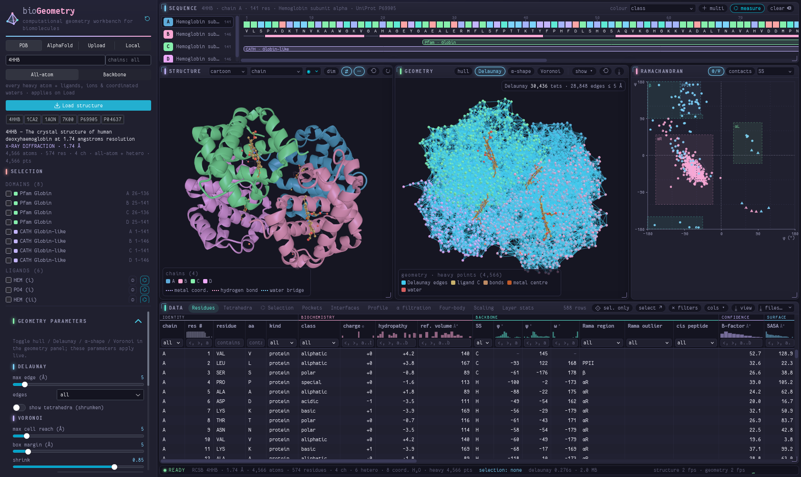

| Area | What it is |
|---|---|
| **Sidebar** (left) | Sources and loading, the **SELECTION** list (domains, ligands, ions, coordinated waters), and the geometry parameters, analyses, display options, load options and downloads |
| **Sequence** (top) | Chains, residue squares coloured by property, secondary structure and domain bars |
| **Structure** | The molecule as cartoon, trace, spheres or sticks |
| **Geometry** | The computational geometry of the point set: hull, Delaunay, α-shape, Voronoi |
| **Ramachandran** | φ/ψ plot; the *contacts* tab is the Delaunay contact map; *PAE* appears for AlphaFold models |
| **Data dock** (bottom) | Residues and Tetrahedra tables, the Selection measurement, and the analysis tabs |
| **Status bar** | The source, atoms, residues, chains, point set, current selection and timings |

The two 3D views rotate, zoom and pan together (**⇄**, on by default).

## 2. Loading a structure

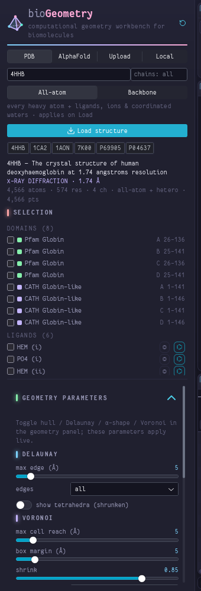

1. **Source:**
   - **PDB**: an entry id, optionally with a chain subset (e.g. `A,B`).
   - **AlphaFold**: a UniProt accession (e.g. `P04637`). The model's pLDDT and PAE come with it.
   - **Upload**: drop a `.pdb` / `.cif` file (also gzipped).
   - **Local**: type a folder or file path, click **List**, pick a file.
   - **Examples**: one click loads 4HHB, 1CA2, 1AON, 7K00, P69905 or P04637.
2. **Mode:**
   - **All-atom**: every heavy atom of the polymer.
   - **Backbone**: one point per residue (Cα for protein, P for nucleic acids).

   Both include every atom of the ligands, ions and coordinated waters. Backbone is the right choice for very large assemblies.
3. **Load structure.** The structure, sequence and Ramachandran views appear first; the residue feature table follows in the background.

Under the button, the sidebar shows the entry title, method, resolution and a summary of atoms, residues, chains and points. **Load options** sets a biological assembly and whether coordinated waters are kept. Only waters that coordinate an ion or bind a ligand are loaded; bulk solvent is dropped.

<br clear="right">

## 3. Selecting

There is **one selection**, shared by every view:

| Action | Effect |
|---|---|
| click | select only this (residue, domain, chain, ligand, point …) |
| ctrl / ⌘ + click | add or remove it |
| shift + click | add a range |
| drag in the sequence, brush in a plot | select the range or region |
| **＋ multi** (or `M`) | every click adds or removes, every drag adds |
| **clear** (or `Esc`) | empty the selection and its highlights |

The sidebar's **SELECTION** list holds the structure's domains, ligands, ions and coordinated waters:

- **tick** a row to add it to the selection
- **◎** selects a ligand with its binding site (residues within 4.5 Å)
- **⌬** selects a ligand or ion with its **coordination sphere**: the residues bound to it, the coordinating waters and what those waters bridge to. It then flies to the group and measures it (section 8).

Selected residues are outlined in the structure view, marked in the sequence and Ramachandran plot, and highlighted in the tables. *sel. only* in the dock shows only the rows involving the selection; *select ↗* turns the current table filters into the selection.

## 4. Structure view

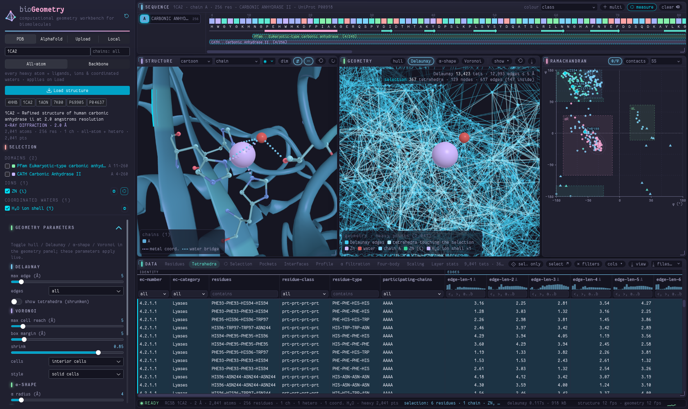

- **Style and colour:**
  - Choose cartoon, trace, spheres or sticks.
  - Colour by chain, secondary structure, residue class, B-factor / pLDDT, hydropathy, N→C, element, burial (RSA), Voronoi volume, hull depth or Delaunay contacts.
  - The legend explains the colours.
- **Ligands** are ball-and-stick, coloured by role:

  | Part | Colour |
  |---|---|
  | carbon | tan |
  | bonds | light brown |
  | metal centre (e.g. haem Fe) | rust |
  | N, O, S | standard element colours |

- **Ions** are spheres with a colour per element, and **coordinated waters** are muted red. Ligands, ions and waters look identical in the geometry view.
- **Dotted lines** show what binds a ligand or ion:

  | Line colour | Contact |
  |---|---|
  | violet | metal coordination |
  | pink | hydrogen bonds |
  | blue | water bridges |
  | grey | covalent links |

  In the example above, the zinc of carbonic anhydrase II sits on His94, His96 and His119.
- **Selection display:** a selection of up to 16 residues also shows its side chains as sticks.
- **Toolbar:**
  - **dim** fades everything not selected
  - **◉** picks the selection colour
  - **⇄** links the cameras
  - the binding-line toggle shows or hides the dotted lines
  - **⟲** resets the view, **↻** spins, **▤** clips to a slab
  - **⤓** saves a PNG

## 5. Geometry view

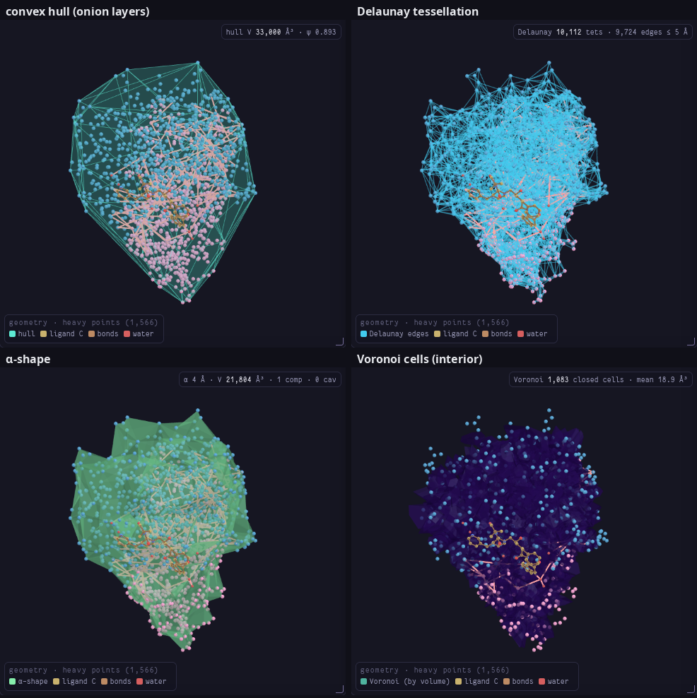

The chips switch the layers on and off, and their parameters live in the sidebar under **Geometry parameters**, where they apply live:

| Layer | Shows | Parameters |
|---|---|---|
| **hull** | the convex hull, with onion layers | — |
| **Delaunay** | the tessellation's edges (sky blue) and nodes | max edge (5 Å all-atom, 10 Å backbone), edge set, optional shrunken tetrahedra |
| **α-shape** | the union of Delaunay tetrahedra with circumradius ≤ α | α |
| **Voronoi** | Voronoi cells coloured by volume; *interior cells* by default, *all cells* closed by the bounding box | max cell reach, box margin, shrink, style |

**When something is selected,** every Delaunay tetrahedron it takes part in is highlighted:

- its edges turn a lighter sky blue and become slightly thicker;
- its nodes grow and take the selection colour;
- the top-right counter gives the number of tetrahedra, nodes and edges.

Ligands, ions and waters are drawn on top of the tessellation so edges never hide them. **show ▾** sets the point size and toggles the points, the cartoon underneath, the selection tetrahedra, the selection geometry and the analysis overlays.

## 6. Ramachandran, contacts and PAE

- **φ/ψ:** every residue's backbone dihedrals, with density contours and the αR, β, PPII and αL basins. Gly is drawn as ▲ and Pro as ■, and the dotted lines at φ = 0 and ψ = 0 mark the quadrants. Brush a region to select its residues.
- **contacts:** the Delaunay contact map (residue × residue). Brush a block to select both sides.
- **PAE** (AlphaFold models): the predicted aligned error matrix. Dark means a confident relative placement.

Nucleotides have no φ/ψ, so a DNA- or RNA-only structure has an empty φ/ψ plot (section 11).

## 7. The data dock

- **Residues:** one row per residue. The columns are grouped:

  | Group | Columns |
  |---|---|
  | identity | chain, number, name, kind |
  | biochemistry | class, charge, hydropathy, reference volume |
  | backbone | secondary structure, φ/ψ/ω, Ramachandran region, outliers, cis peptides |
  | confidence | B-factor or pLDDT |
  | surface | SASA, RSA, exposure, depth, depth class |
  | geometry | Voronoi volume and packing, hull depth, convex layer, α-surface, Delaunay degree |
  | interactions | H-bonds, salt bridges, disulfides, interfaces, ligand site, pocket |
  | annotation | domains |

- **Tetrahedra:** one row per compact Delaunay tetrahedron (shown with 1CA2 in section 4):
  - its residues and residue classes
  - edge lengths, face areas, volume, solid angles and circumradius
  - the Voronoi volume, SASA and depth (S / U / B) of each vertex, joined as `depth` (e.g. `SSUU`)
  - tetrahedrality, Tropsha class, α-shape membership, EC number and class, and interaction type

  The tetrahedra involving the selection are listed first.
- **Selection, Pockets, Interfaces, Profile, α filtration, Four-body, Scaling, Layer stats:** see sections 8 and 9.

Each column has a histogram (click a bar to filter on that range) and a filter box:

- **numeric:** `>0.5`, `<=3`, `=2`, `1..4`, `blank`, `!blank`
- **categorical:** a dropdown, `contains`, `!text` or `=text`

**cols ▾** hides columns; hovering over a header explains it; **⤓ view** saves the table as shown.

## 8. Measuring a selection

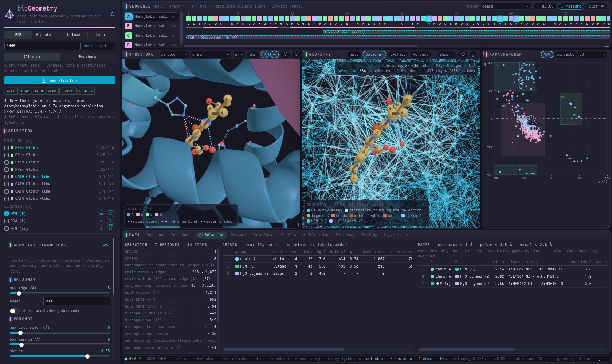

Select what you want to compare, then press **⌬ measure** (or `G`, or *Measure selection* in the sidebar's Analyses). Examples: a domain and a ligand, a metal site, two chains, or ⌬ on a ligand.

The selection is split into **groups**: domains or chain segments, each ligand and ion, and the coordinated waters. The **Selection** tab reports:

- **the whole selection:**
  - the Delaunay tetrahedra it takes part in (the same set the geometry view highlights), with their volume and neighbouring residues
  - hull and α-shape volume and area, radius of gyration
  - SASA alone and in the structure, and the surface buried by the rest
- **each group:** residues, atoms, radius of gyration, hull, sphericity, and buried fractions
- **each pair of groups:** minimum distance and closest atoms, contacts ≤ 4 Å, polar contacts ≤ 3.5 Å, metal coordination ≤ 2.8 Å, Delaunay contacts, and the buried surface on association

In haemoglobin (above), ⌬ on HEM (i) gives His87 NE2–Fe at 2.14 Å. The geometry view draws each group's hull and the contacts between groups. Clicking a pair row shows only that pair.

## 9. Analyses

Run analyses from the sidebar's **Analyses** section; their results open in the dock and as overlays in the geometry view.

**Pockets / cavities.** Two-probe pockets: the space a small probe reaches but a large one cannot.

- The table lists each pocket's volume, mouth area, residues and lining.
- Click a pocket to select its lining residues and fly to it; click it again to deselect it.
- Pockets are found in the polymer alone, so a bound ligand does not fill its own pocket.
- Not every structure has pockets: an empty result is an answer, not an error.

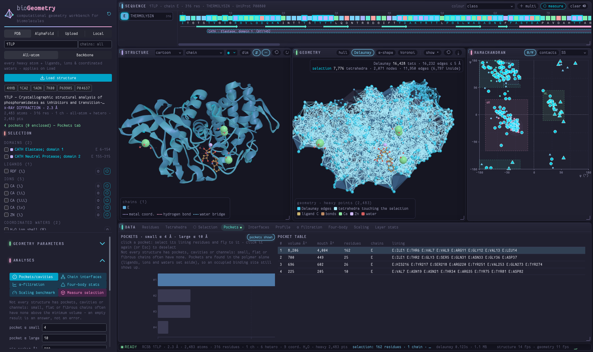

**Chain interfaces.** The inter-chain Delaunay contacts, as a chain × chain matrix and a table. Click a cell to draw that interface and select its residues. Below, the two chains of HIV-1 protease share 157 contacts across 92 interface residues.

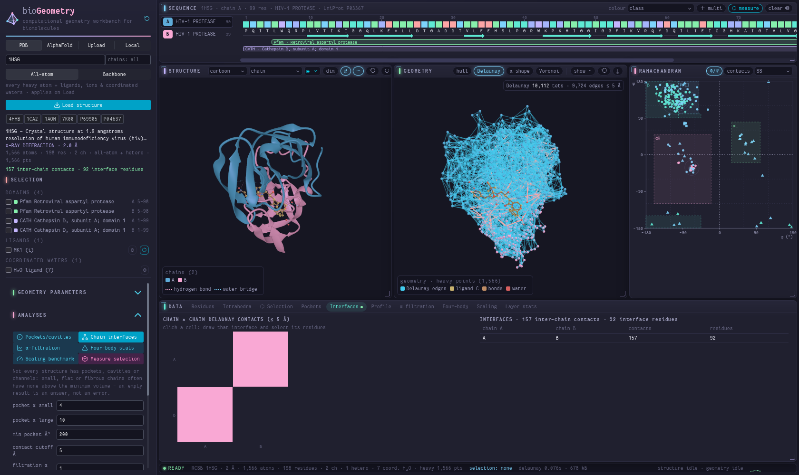

**α-filtration.** The α-shape's volume (relative to the hull), surface area, connected components and enclosed cavities as α grows. The dashed line marks the current α.

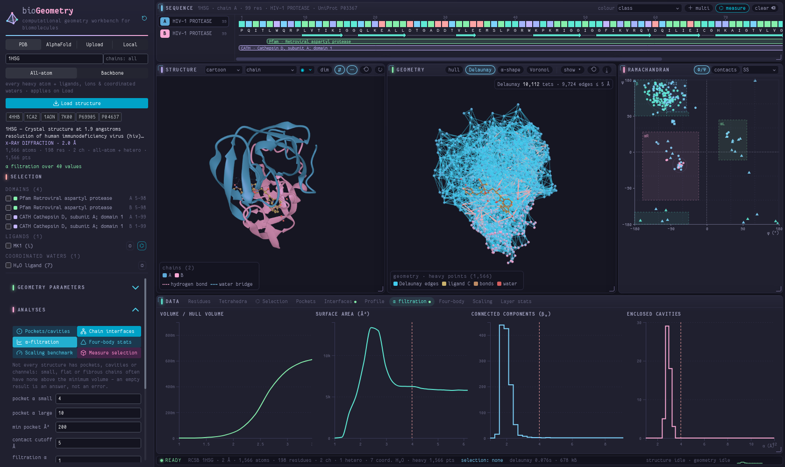

**Four-body statistics.** Over-represented residue quadruplets in compact tetrahedra, scored by log(f_obs / p_multinomial).

**Scaling benchmark.** Wall time against the number of points for each algorithm, on log-log axes.

**Profile** and **Layer stats.** *Profile* plots any residue feature along the sequence; brush along it to select residues. *Layer stats* lists the cost and size of each computed layer.

## 10. Large assemblies and AlphaFold models

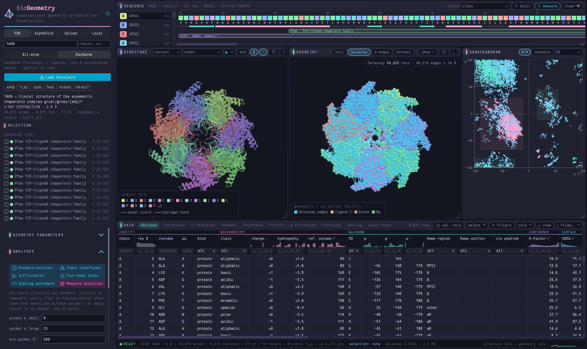

**Large assemblies.** GroEL–GroES (1AON: 21 chains, 59 k atoms) and the 70S ribosome (7K00) load in seconds in **Backbone** mode.

- The feature table is computed in the background.
- Memory is budgeted: a computation that would not fit is refused with a message, not a crash.

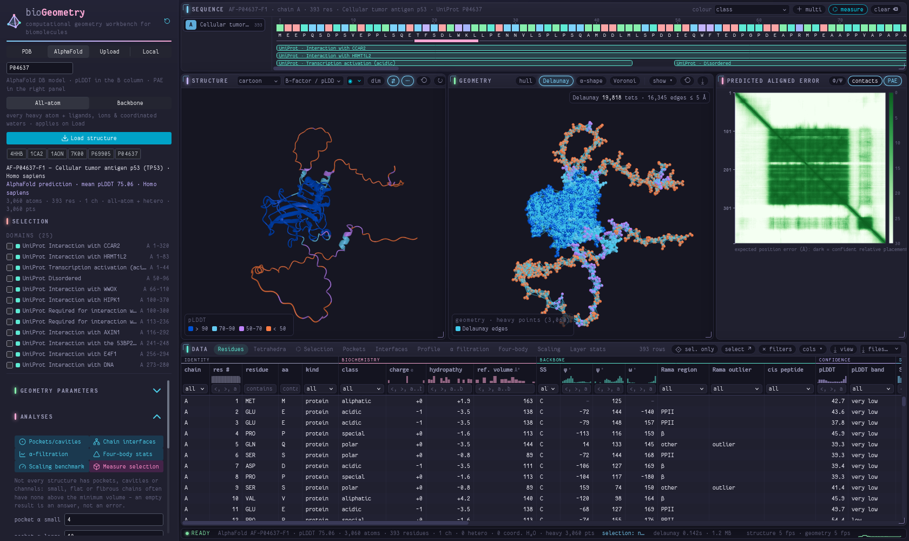

**AlphaFold models.** These come with:

- **pLDDT** in the B-factor column: colour by *B-factor / pLDDT* to see the confident core (blue) and the disordered tails (orange)
- the **PAE** matrix in the right panel
- UniProt features as domain bars

## 11. DNA, RNA and the standalone workbench

| | |
|---|---|
| 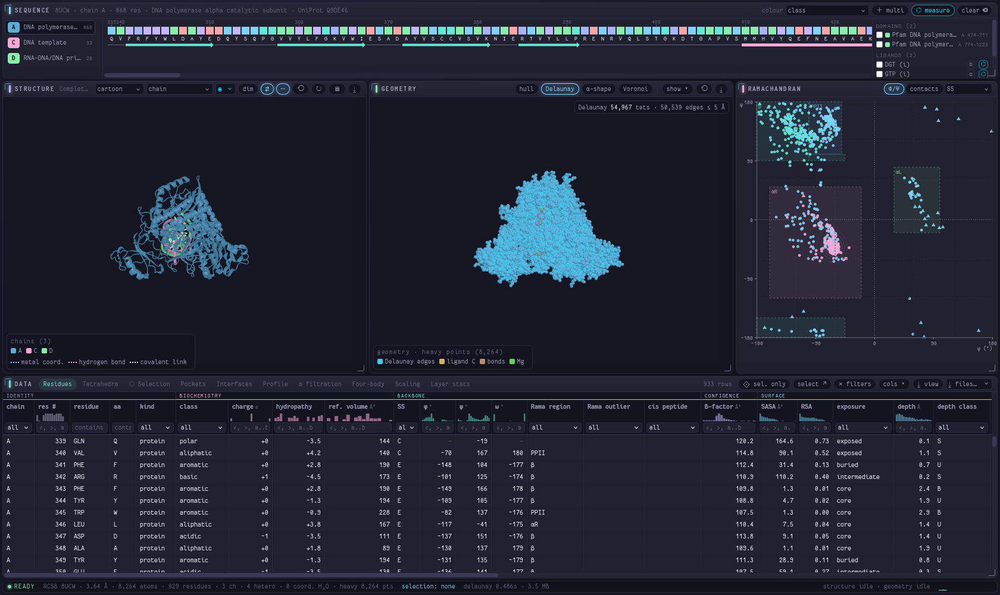 | 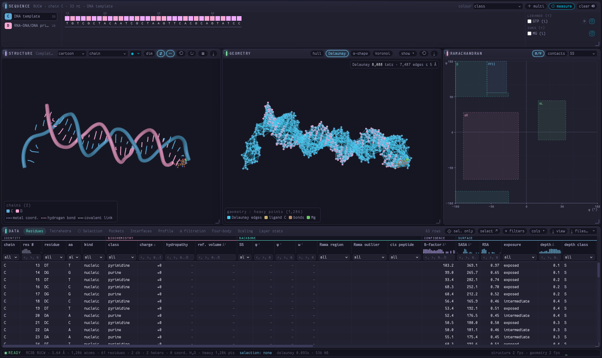 |
| 8UCW: DNA polymerase α with its DNA template and RNA–DNA primer | the nucleic-acid chains only (`&chains=C,D`) |

These screenshots show the **standalone workbench**, the same workbench served without the app (`python serve_standalone.py`, port 8770) and configured through the URL. It has **no sidebar**: the domain / ligand / ion list sits beside the sequence, and the sources, parameters and analyses are not available as buttons.

8UCW contains the polymerase, so its φ/ψ plot shows the protein residues. With only the DNA chains, the **Ramachandran panel is empty**, because nucleotides have no φ/ψ.

DNA and RNA load in the full app too, through PDB, Upload or Local.

```
http://localhost:8770/workbench/index.html?api=http://localhost:8770&pdb=8UCW
   &chains=C,D            chain subset            &mode=ca       Backbone mode
   &path=/abs/file.cif    a local file            &af=P04637     an AlphaFold model
   &layers=alpha,voronoi  &analysis=pockets  &tab=tetrahedra  &select=87,92
```

> **Note on nucleic-acid structures.** The workbench loads DNA and RNA and computes their computational geometry as it does for proteins: tessellation, hull, α-shape, Voronoi cells, surface, depth and contacts. Many residue features and analysis labels, however, are still defined for proteins, for example charge, secondary structure and Ramachandran basins. For nucleic acids these features and their nomenclature are therefore not yet accurate, and should be read with care. Nucleic-acid-specific analysis is work in progress.

## 12. Downloads

The sidebar's **Downloads** section saves files directly, without opening a tab:

- **Structure file:** the loaded model as **mmCIF** or **PDB**, with chains, assembly and coordinated waters exactly as shown.
- **CSV tables:**
  - `residue-features`
  - `delaunay-tetrahedra`
  - `hull-triangles`
  - `pockets`
  - `residue-contacts`

Files are named `bioGeometry_<id>-<chains>_<atom set>_<content>.csv`, for example `bioGeometry_1CA2-A_all-atom_delaunay-tetrahedra.csv`. A dock table saved with *⤓ view* ends in `_<tab>-view.csv`.

## 13. Keys and reset

| Key | Action |
|---|---|
| `Esc` | clear the selection, its measurement and highlights |
| `M` | multi-select on / off |
| `F` | focus the selection |
| `G` | measure the selection |
| `R` | reset the cameras |
| `S` | spin |
| `C` | slab |
| `L` | link or unlink the cameras |
| `Shift+X` | reset the workbench |

**Resetting.** The **⟲** button next to the bioGeometry name clears the selection, analyses, overlays and filters, and restores the default layers, parameters and display.
